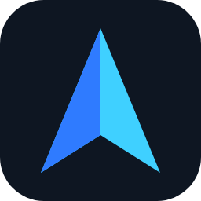

<h1 align="center">Recon</h1>

A companion app for the game <b>Rust</b>: live map, teammates, raid alarms, node heatmaps, raid planner and more. Windows.

  <a href="https://github.com/D1TMbot/recon/releases/latest/download/Recon-Setup.exe"><b>⬇ Download Recon for Windows</b></a>

---

## Install

1. Click **[Download Recon for Windows](https://github.com/D1TMbot/recon/releases/latest/download/Recon-Setup.exe)** above (`Recon-Setup.exe`).
2. Open it. Windows may say **"Windows protected your PC"** because the installer isn't digitally signed yet: click **More info → Run anyway**.
3. Click through the installer. Recon opens when it's done, and it's in your Start menu.

Nothing else to install: Recon brings everything it needs. It installs for your user only (no admin password), and you can remove it any time in **Settings → Apps**. Recon updates itself when new versions come out.

> **Smart App Control on?** Windows blocks unsigned installers completely when Smart App Control is turned on. Use the zip instead: download `Recon-v….zip` from the [latest release](https://github.com/D1TMbot/recon/releases/latest), unzip it somewhere permanent and double-click **Install Recon.cmd**.

> Don't use GitHub's green **Code → Download ZIP** button. That's the source code, not the app.

## Connect your Rust server

1. Start Rust and join your server.
2. In Recon, click **+** (bottom left) and sign in with Steam in the window that opens. Read Facepunch's notice and press **Login with Steam**.
3. In Rust, press **ESC → Rust+ → Pair with server**.

Your Rust+ sign-in lasts 14 days; Recon tells you when to sign in again.

## Features

- Live map with teammates, trails, monuments, events (Cargo, Heli, Chinook, locked crate timers) and day/night clock
- Raid alarms: loud siren in Recon and push alerts to your phone (free ntfy app)
- Node heatmaps for stone, metal and sulfur predicted from the map's terrain, plus farm routes near your base
- Raid planner (cheapest explosive mix and total sulfur), crafting and recycling calculator
- Vending machine search (on servers that share shops), team chat, smart switches and automations
- Upkeep tracker and calculator (how long your TC lasts), wipe countdown, server population graph, shared map markers
- Sulfur stash tracker: what your monitored boxes hold vs. what a raid plan needs
- Recon on your phone (home Wi-Fi or Tailscale)

## Privacy

Your Steam sign-in and settings stay on your own PC in `%APPDATA%\Recon`. Recon talks to Facepunch's Rust+ service, GitHub (update checks) and, only if you turn on phone alerts, ntfy.sh.

Recon is a fan project and isn't made by or affiliated with Facepunch Studios.
